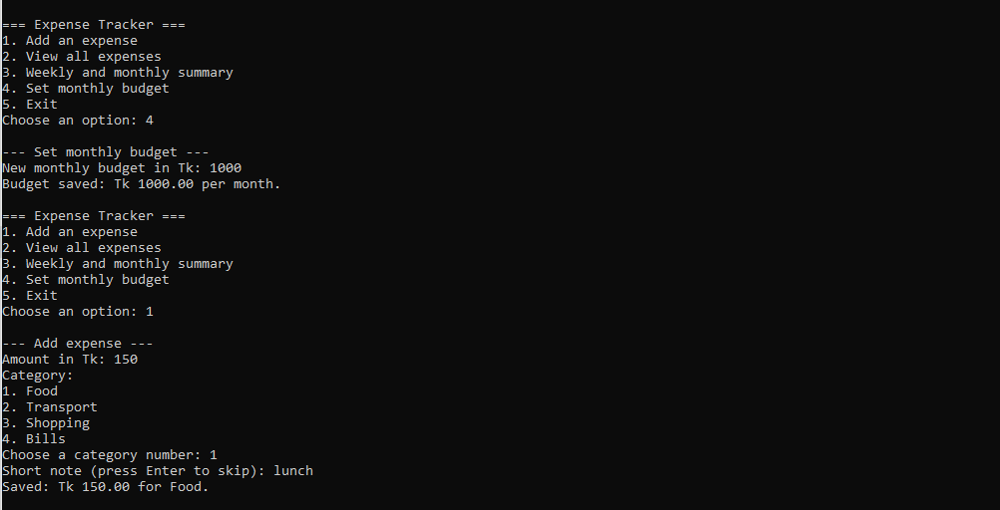
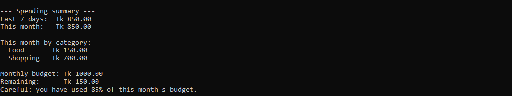
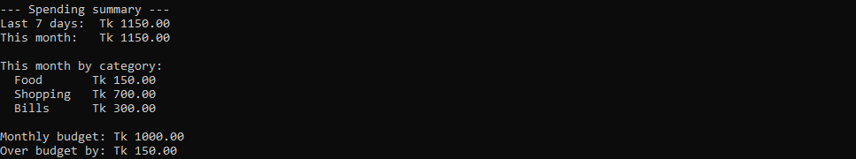

# Expense tracker

A small Python program that records daily expenses, sorts them into categories, and shows how much is left of a monthly budget. Amounts are in Bangladeshi Taka (Tk).

## What it does

- Records an expense with an amount, a category (Food, Transport, Shopping or Bills) and a short note
- Shows every saved expense
- Adds up spending for the last 7 days and for the current month
- Shows this month's spending for each category
- Lets you set a monthly budget, then shows how much is left
- Warns when 80% of the budget is used, and says by how much you are over if you go past it

## Screenshots

Setting a monthly budget of Tk 1000 and adding a Food expense of Tk 150:

After another expense of Tk 700 for Shopping, the summary shows spending by category, the money left, and a warning at 85% of the budget:

After one more expense, the summary shows that the budget has been passed by Tk 150:

## How to run it

Install Python from python.org and put `expense_tracker.py` in a folder. Open a terminal in that folder and type `python expense_tracker.py`.

The program creates `expenses.csv` and `budget.json` by itself the first time it saves something.

## Project files

- `expense_tracker.py`: the whole program
- `expenses.csv`: one row per expense, with the date, category, amount and note
- `budget.json`: the monthly budget, so it is remembered after the program closes

## What was hard

The hardest part was learning how to save expense records and calculate weekly spending correctly. Since I am still a beginner in Python, understanding how to organize the data and work with dates took some time. I had to test the program several times to make sure it worked properly.

## What I learned

I learned how Python can save information in a file and retrieve it later, even after closing the program. I also learned how to work with dates to calculate weekly expenses. This helped me understand that programming can solve real-life problems.

## What I would add next

If I had more time, I would like to make the program easier for my father to use by adding a simple graphical interface, larger buttons and clearer expense reports. I would also like to add reminders and monthly charts to make managing expenses easier.

## A note on how I built it

I used an AI assistant as a guide while learning, and I tested and changed the program myself.
